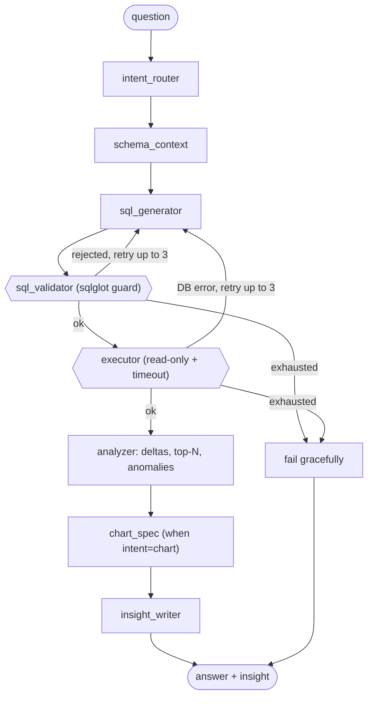

# Architecture

How the Sales Intelligence Platform is put together and how a request flows
through it. Companion docs: [SCHEMA.md](SCHEMA.md) (raw tables),
[DASHBOARD_SPEC.md](DASHBOARD_SPEC.md) (product spec),
[API.md](API.md) (endpoint reference),
[SPEC_COMPLIANCE.md](SPEC_COMPLIANCE.md) (spec → code status),
[DECISIONS.md](DECISIONS.md) (why each choice).

> **Status:** Phases 0–5 are built — schema discovery, the data layer + dashboard
> API, the React dashboard UI, the LangGraph agent + SQL guard + CLI, the AI
> features in the dashboard (per-chart insights, "Summarize dashboard", streaming
> chat), and the report composer (Markdown + PDF). The scaling/eval/Docker work
> (Phase 6) is the remaining phase — marked _(planned)_ below.

---

## 1. Core principle — the LLM never reads raw rows

Every number on the dashboard comes from **deterministic, parameterized SQL**
against a pre-aggregated reporting layer (`mart.*`). No LLM is involved in Phase
1 at all. When the agent arrives (Phase 3) it will only ever: write SQL, let the
database aggregate, and read back **small aggregated results** (≤ ~200 rows).
This keeps results trustworthy, cheap, and injection-resistant.

---

## 2. Layers

```
                    CockroachDB (defaultdb)
  ┌───────────────────────────────────────────────────────────┐
  │  olist.*   raw source tables (read-only)   — see SCHEMA.md  │
  └───────────────────────────────────────────────────────────┘
                              │  db/views.sql  (rebuilt by
                              │  python -m db.refresh_mart)
                              ▼
  ┌───────────────────────────────────────────────────────────┐
  │  mart.*   reporting layer (pre-aggregated, indexed)         │
  │    order_facts · order_item_facts · daily_sales            │
  └───────────────────────────────────────────────────────────┘
                              │  read-only, parameterized SQL
                              ▼
  backend/                                             (Python 3.11+)
    db/session.py        engine + read_only_session (SET TRANSACTION READ ONLY)
    api/filters.py       global filters → SQL fragments (bound params only)
    services/charts.py   one query function per chart/KPI  ← deterministic SQL
    services/cache.py    TTL cache keyed by hash(sql + params)
    api/dashboard.py     FastAPI routes  (/api/...)
    app/main.py          FastAPI app + CORS
                              │  JSON
                              ▼
    frontend/  React + Vite + TS, Recharts, TanStack Query   ← dashboard UI
    agent/     LangGraph agent (state·graph·nodes·llm·cli)    ← NL→SQL→insight
    guards/    sql_validator.py (sqlglot guard)              ← security boundary
```

Namespace packages (no `__init__.py`); modules resolve via `pythonpath = ["."]`
from `backend/` (see `pyproject.toml`).

---

## 3. The reporting layer (`mart.*`)

Built by [`backend/db/views.sql`](../backend/db/views.sql) as **tables** (not
materialized views — see DECISIONS.md D1) and rebuilt with
`python -m db.refresh_mart`. The build enforces the data-quality rules from
DASHBOARD_SPEC.md §4 (no fan-out, deduped reviews, one payment type per order).

### `mart.order_facts` — one row per order (99,441 rows)
`order_id, purchase_date, purchase_month, customer_unique_id, customer_state,
status, items_gmv, freight, n_items, payment_value, main_payment_type,
max_installments, review_score, delivery_days, estimated_days, delay_days,
is_late, delay_bucket`

Items, payments and reviews are each aggregated to order grain in separate CTEs
**before** joining onto `orders`, so order-level sums never fan out.
Indexes: `purchase_date, purchase_month, customer_state, status, delay_bucket`.

### `mart.order_item_facts` — one row per order item (112,650 rows)
`order_id, purchase_date, purchase_month, customer_state, status, product_id,
category, seller_id, seller_state, price, freight_value`
Indexes: `purchase_date, customer_state, category, status, seller_id, order_id`.

### `mart.daily_sales` — additive rollup (58,019 rows)
Grain: `date × purchase_month × customer_state × category × status`
Measures: `gmv, orders, items, freight`
(`status` added to the grain vs. the spec so the global status filter applies
uniformly — DECISIONS.md D5.)
Indexes: `date, purchase_month, customer_state, category, status`.

**Which table backs which metric** (the additive-vs-distinct rule, DECISIONS.md
D6): additive measures (gmv/items/freight) sum safely from `daily_sales`;
distinct order counts come from `order_facts`/`order_item_facts`. See API.md for
the per-endpoint mapping.

---

## 4. Request lifecycle (a chart endpoint)

```
GET /api/charts/trend?date_from=…&states=SP,RJ&granularity=month
        │
        ├─ filter_params()      parse global filters → Filters dataclass
        │                       (unknown statuses dropped; CSV → list)
        ├─ charts.trend(f, …)   build parameterized SQL + bound params
        │     └─ Filters.where("order_facts") → WHERE clauses + :params
        ├─ query_cache.cached(sql, params, loader)   hash(sql+params) → hit? return
        │     └─ loader(): read_only_session → SET statement_timeout → execute
        └─ JSON  { "data": [ {period, gmv, orders, aov}, … ], "meta": {…} }
```

Key safety properties:
- **Read-only:** every query runs inside `SET TRANSACTION READ ONLY`.
- **Parameterized:** filter values are bound (`:date_from`, `= ANY(:states)`),
  never string-formatted — injection-safe by construction.
- **Bounded:** a per-query `statement_timeout` (default 5000 ms) is set.
- **Cached:** identical (sql, params) are served from an in-process TTL cache.

---

## 4a. Frontend (Phase 2)

React + Vite + TypeScript SPA in [`frontend/`](../frontend), using **Recharts**
for charts and **TanStack Query** for data fetching/caching.

```
frontend/src/
  api/        client.ts (fetch) · types.ts · hooks.ts (one Query hook per endpoint)
  state/      filters.tsx — global filter context (date/state/category/status)
  lib/        format.ts (BRL, %, ★, periods) · colors.ts (fixed per-dimension palette)
  components/ GlobalFilterBar · KpiCards · ChartCard (+ AI-insight placeholder)
              ChatPanel (placeholder) · PartialPeriodWarning · ui.tsx (primitives)
              charts/  one component per chart (1–8)
  pages/      Dashboard.tsx — the §7 layout (filter bar · KPI row · 2-col grid · chat)
```

Key choices:
- **Global filters** live in one context; every chart hook composes them with its
  own local params, so changing a filter refetches every card. `keepPreviousData`
  keeps the old chart visible while refetching (no blank flash — spec §10).
- **Dev proxy:** `vite.config.ts` proxies `/api` → the FastAPI backend, so the
  browser makes same-origin calls (no CORS in dev). In other environments set
  `VITE_API_BASE`.
- **Consistent colour** per payment type / delay bucket / review score across
  charts (`lib/colors.ts`), BRL formatting everywhere, units in every title
  (spec §10). Light/dark via CSS variables.
- The per-card **AI-insight box** and the side **chat panel** are placeholders
  wired to real behaviour in Phase 4.

Run: `cd frontend && npm install && npm run dev` → http://localhost:5173
(backend must be running on :8000).

## 4b. The agent (Phase 3)

A **LangGraph** `StateGraph` turns a natural-language question into a validated
SQL query, runs it against `mart.*`, analyses the aggregated rows in Python, and
writes a numbers-grounded insight. One `AgentState` ([agent/state.py](../backend/agent/state.py))
flows through every node; an in-memory checkpointer persists it per `thread_id`
for follow-ups.



Nodes ([agent/nodes/](../backend/agent/nodes)):
1. **intent_router** → `qa | chart | summary | report`
2. **schema_context** → injects the mart schema + metric rules (never the data)
3. **sql_generator** → NL→SQL (LLM); on a retry it is re-fed the previous SQL + error
4. **sql_validator** → the `sqlglot` guard ([guards/sql_validator.py](../backend/guards/sql_validator.py));
   reject → back to the generator with the reason
5. **executor** → read-only, `statement_timeout`; DB error → back to the generator
   (both loops capped at 3 tries, then **fail** answers gracefully)
6. **analyzer** → computes deltas / top-N / Black-Friday detection in **Python**
   from the aggregated rows (the LLM does no arithmetic)
7. **chart_spec** → validated `{type,x,y,series}` when the intent is a chart
8. **insight_writer** → 2–3 sentence summary using only the analyzer's numbers

**The LLM is provider-agnostic** ([agent/llm.py](../backend/agent/llm.py)): with
`LLM_API_KEY` set it calls Anthropic (`LLM_MODEL`, default `claude-opus-5-5`);
without a key it falls back to a deterministic **stub** (keyword routing + SQL
templates + templated insights) so the CLI and tests run offline. Try it:
`python -m agent.cli "top 5 categories by revenue"`.

### Why LangGraph

- **The control flow is a graph, not a straight line.** The validator→generator
  and executor→generator **retry loops** with a bounded counter are conditional
  edges — the natural LangGraph primitive. Expressing "retry up to 3 times, then
  fail gracefully" as a hand-rolled `while` loop would scatter that logic across
  the nodes.
- **Durable per-conversation memory for free.** The checkpointer persists
  `AgentState` by `thread_id`, so a follow-up ("now only for SP") resumes with the
  prior turns — no session store to build.
- **Deterministic and LLM steps are separate, inspectable nodes.** Routing,
  NL→SQL, chart spec and insight use the LLM; schema injection, validation,
  execution and analysis are pure code. Each node is unit-testable in isolation,
  and the graph makes the data flow legible (and easy to add report-composition
  to in Phase 5).
- **Alternatives rejected:** a plain function pipeline (no first-class
  branch/retry/checkpoint — we'd rebuild all three); a generic ReAct/tool-calling
  agent (lets the LLM choose tools freely, which fights the "LLM never touches raw
  rows / only validated SQL runs" guarantee); raw SQL string checks (a parser, not
  regex, is required to stop injection). LangGraph keeps the LLM boxed into exactly
  the steps we want while the guard and the database stay in control.

## 4c. AI in the dashboard (Phase 4)

The agent is wired into the dashboard through three endpoints
([api/insights.py](../backend/api/insights.py), [api/chat.py](../backend/api/chat.py))
and a service ([services/insights.py](../backend/services/insights.py)):

- **Per-chart insight** — `GET /api/insights/{chart_id}` (same global filters +
  the chart's local params). It fetches the **same aggregated rows the chart
  shows**, runs the shared `summarize_rows` analyzer, and has the LLM write a
  2–3 sentence insight. Cached by `hash(chart_id + params)`. There's also
  `/api/insights/kpis`.
- **Summarize dashboard** — `GET /api/insights/summary` gathers the KPI facts +
  key-chart facts and returns a headline / 3 drivers / 1 risk / 1 recommendation.
- **Chat** — `POST /api/chat` runs the agent and **streams SSE**: a `status`
  event per graph node, then one `final` event with the answer, the validated
  SQL, an optional `chart_spec` + capped rows (rendered inline), and the
  `thread_id` (the agent's checkpointer gives follow-up memory).

Frontend: the per-card insight box ([AiInsightBox](../frontend/src/components/AiInsightBox.tsx))
and KPI insight generate **on demand** (one click) so a load or filter change
doesn't fire an LLM call per card; the chat panel ([useChat](../frontend/src/hooks/useChat.ts))
consumes the SSE stream and renders inline charts. Every insight still obeys the
core rule — the LLM only ever sees aggregated numbers.

## 4d. Reports (Phase 5)

The `report` intent branches from `intent_router` to a **report_composer** node;
the dashboard's "Generate report" button hits the same builder with the current
filters ([services/report_builder.py](../backend/services/report_builder.py),
[api/reports.py](../backend/api/reports.py)).

Pipeline: **plan sections** (rule-based, by topic keywords — e.g. a regional topic
→ trend + revenue-by-state + late-by-state, capped at 5) → run the **deterministic
chart queries** (reusing `services/charts`) → **render charts server-side** with
matplotlib (Agg backend, no system deps) → write a **numbers-grounded narrative**
per section + an **executive summary** (headline / 3 drivers / 1 risk / 1
recommendation) → assemble **Markdown** (charts embedded as base64 PNGs, one
self-contained file) and a **PDF** (matplotlib `PdfPages`: cover + one page per
section).

`POST /api/reports` returns the report metadata + Markdown and URLs to download
`GET /api/reports/{id}.pdf` and `.md`. Reports are held in an in-process store
(dev; single process). A chat message with the `report` intent also returns a
`report_id` with inline download links.

## 5. Configuration & security

- All secrets come from `.env` (git-ignored); only `.env.example` is committed.
  `app/config.py` loads them via `pydantic-settings`.
- `DATABASE_URL` uses `cockroachdb+psycopg://` with `sslmode=verify-full`
  (root cert at `%APPDATA%\postgresql\root.crt`).
- `DATABASE_URL_READONLY` is reserved for a dedicated read-only role for the
  agent's SQL (recommended outer boundary; the agent reads `mart.*`/`olist.*`).
- The agent's generated SQL passes the `sqlglot` guard
  ([guards/sql_validator.py](../backend/guards/sql_validator.py)): single
  statement, SELECT/WITH only, table + column whitelist, enforced LIMIT, comments
  stripped — then runs read-only with a `statement_timeout`. User chat text is
  untrusted and can never alter the prompts or the guard. Phase 1's deterministic
  SQL doesn't need the guard but follows the same read-only / parameterized /
  timeout discipline.

---

## 6. Phase status

| Phase | Scope | Status |
|---|---|---|
| 0 | Schema discovery → SCHEMA.md | ✅ done |
| 1 | `mart.*` + dashboard API + tests | ✅ done |
| 2 | React/Vite dashboard UI | ✅ done |
| 3 | LangGraph agent + SQL guard + CLI | ✅ done |
| 4 | AI insights + chat in the dashboard | ✅ done |
| 5 | Report composer (Markdown + PDF) | ✅ done |
| 6 | Synthetic 1M rows, benchmarks, evals, README, Docker | ⬜ planned |
